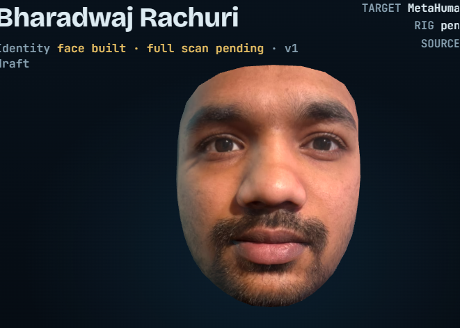

# Embodied Personal Digital Twin

> A **provenance-aware, photoreal digital twin of a real person** that becomes an **embodied agent** living in a persistent virtual world — a twin that is **measurably faithful** to the real person and that **never presents a fabricated memory as fact**.

**Status:** active independent R&D project · Track 1 reconstruction at **v3** (measured) · Track 2 embodied console at **v1 prototype** · everything builds and runs locally.



*Current output: face identity build, rendered against a MetaHuman target rig (v1 draft — full photogrammetry scan pending).*

---

## The goal

Build a persistent digital model of a real, consenting person — appearance, voice, memories, personality, relationships and routines — and give it a body so it can **perceive, remember, reason, and act** inside a simulated world. Not a chatbot with an avatar: an agent whose behaviour is grounded in a faithful model of a specific human, and whose every belief is traceable to where it came from.

The project runs on **two tracks that are built to converge**:

1. **Digital-human reconstruction** — the body and face, rebuilt measurably from photographs.
2. **Embodied-agent console** — perception, memory, reasoning, planning and action in a 3D environment.

The end state is the reconstructed human *driving* the embodied agent.

---

## Why I chose this

I come from reinforcement learning for dexterous robotics (my MSc project trained the Shadow Dexterous Hand with PPO in MuJoCo). That work taught me one lesson repeatedly: **an agent will happily optimise the wrong thing** if the reward or the world-model is even slightly misspecified. A digital twin is the same problem at a larger scale — an agent acting *on a person's behalf* is only safe if its model of that person, and its memory of what happened, are honest and checkable.

So this project is deliberately aimed at the two parts most demos skip:

- **Fidelity you can measure** — not "looks like him," but a number against a reference photo.
- **Memory you can trust** — not a confident guess, but a fact tagged with where it came from and how sure the system is.

---

## Why it's a hard problem worth solving

Most "digital human" demos optimise for a flattering render and a smooth conversation. The genuinely useful — and genuinely hard — problems are the ones underneath:

- **Measurable faithfulness.** A twin that acts for you must resemble *you*, provably, not approximately. That means reconstructing a real mesh from real photos and scoring it against those photos.
- **Honest memory.** Any assistant that remembers your life will, sooner or later, be asked something it doesn't actually know. The dangerous failure is answering anyway. This system is built so memory **carries provenance and confidence and refuses to fabricate**.
- **Grounded action.** "Where are my keys?" is only answerable if perception, memory and planning are wired together — the agent has to search where it last saw them, update its beliefs when the world changes, and replan.

Get these right and you have the foundation for an assistant that can be *trusted to act*, not just to talk.

---

## How it helps people — now and in the future

- **Personal AI that acts on your behalf** — runs errands and routines inside your digital home, grounded in a real model of you and your preferences, with memory you can audit.
- **Accessibility and presence** — a faithful embodied twin can represent someone who can't be physically present, with identity and consent built in from the start.
- **Training and simulation** — a measurably accurate human model is a better test subject for robotics, care-tech and human–robot interaction than a generic avatar.
- **Honest memory as a public good** — the provenance-and-confidence approach to memory (verified / user-provided / inferred / reconstructed / unknown) is reusable by *any* assistant that stores personal history, well beyond this project.
- **Legacy, with permission** — further out, an opt-in way to preserve how a person looked, sounded and reasoned, under explicit, revocable permissions — never as a deception.

Identity, consent and provenance are treated as **requirements, not add-ons**.

---

## Where it is today — current output

### Track 1 — Digital-human reconstruction (current version: v3)

Reconstructs a single connected head-and-body mesh (**13,380 vertices**) from **8 reference photographs**, built on the MakeHuman CC0 base template, shaped by silhouette-fitted body targets and **453 MediaPipe face landmarks**, with textures baked from the photos.

**v3 corrections, measured against the reference photos:**

| Metric | v2 | v3 |
|---|---|---|
| Eye-opening IoU (visible eyeball vs photographed opening) | 0.60 | **0.80** |
| Front landmark error — nose / lips / jaw (px) | 4.5 / 6.7 / 6.8 | **3.7 / 3.4 / 4.6** |
| Side-profile mean error — left / right photo | 7.1 / 8.2 mm | **5.5 / 7.3 mm** |
| Neck-seam normal agreement (min dot product) | −0.27 | **1.000** (seam removed) |

Key engineering in v3: a second tighter landmark-fit pass; side-profile depth correction applied only where both side photos agree within 8 mm; anatomically-placed eyeballs with lid-region deformation to match the photographed eye opening; welded normals across the neck seam; and per-photo photometric normalisation.

**Validation:** `pytest` — **17 passed** (9 v2 + 8 new v3 checks: structure, non-blank textures, closed neck, no shading seam, eye size/spacing, landmark and profile improvements). Viewer regression — **55 Playwright checks passed** across v1/v2/v3 at two resolutions and three render modes.

**What you can see today:** an interactive viewer (`app/my-twin.html`) switches between v1, v2 and v3 for side-by-side comparison, so each correction is visible rather than asserted.

### Track 2 — Embodied-agent console (v1 prototype)

A single-page Three.js vertical slice: one digital person in a small flat, four tracked objects, two household relationships. A **9-stage pipeline** — Perceive → Understand → Remember → Reason → Plan → Move → Interact → Verify → Communicate.

- **Provenance-aware memory:** every fact is tagged **Verified / User-provided / Inferred / Reconstructed / Unknown**. Memory-only questions answer *with* their provenance and **refuse to fabricate** when the fact isn't known.
- **Belief-driven search:** benchmarks **"Where are my keys?"** and **"Daddy, can you get me the book?"** — the agent searches last-seen → usual place → sweep, updates beliefs from perception, and **replans mid-route** when an object is moved out of sight.

---

## Roadmap — staged plan

The twin is built in stages, each one usable on its own. Status is honest: ✅ done · 🚧 in progress · ⬜ planned.

| # | Stage | What it delivers | Status |
|---|---|---|---|
| 1 | **Digital human** | Measurable face + body reconstruction from photos (now at v3) | 🚧 v3 — body still uses assumed proportions |
| 2 | **Personal identity** | Appearance + voice tied to one authorised, consenting person | 🚧 face done; voice next |
| 3 | **Lifelong memory** | Persistent store with provenance + confidence on every fact | 🚧 schema + console prototype working on sample data |
| 4 | **Personality & behaviour** | Reasoning that reflects the real person's preferences and routines | ⬜ |
| 5 | **Embodiment** | The agent inhabits a body in 3D; perception drives action | 🚧 v1 console prototype |
| 6 | **Persistent virtual world** | A home that persists between sessions; objects keep state | ⬜ |
| 7 | **Household intelligence** | Multi-object, multi-relationship tasks ("get the book for my daughter") | 🚧 two benchmark tasks running |
| 8 | **Lifelong learning + model versioning** | The twin improves over time, with every version tracked and reversible | ⬜ |
| 9 | **Legacy mode (opt-in)** | Preserve a person under explicit, revocable permissions | ⬜ design only |

### Near-term (next versions)

- **Body accuracy:** replace assumed proportions with real tape measurements + photos taken from 3–4 m (removes camera foreshortening).
- **Face:** fit from 8–12 multi-angle photos instead of one front view; model ears from side landmarks.
- **Hair & clothing:** move from painted-on textures to modelled geometry (photogrammetry walk-around).
- **Console:** replace keyword intent parsing with an LLM + tool-calling; swap the stylised avatar for the rigged v3 mesh; real speech input; a persistent memory store using the provenance schema.
- **Convergence:** drive the embodied console with the reconstructed v3 digital human.

---

## Architecture

```
reconstruction/
  tools/seg.py, recon_head.py, recon_body.py, merge.py   # v1 silhouette carving
  tools/twin/fit_body.py, build_twin.py                  # v2 fitted template
  tools/twin/build_twin_v3.py, facefit.py, face_audit.py, body_validate.py  # v3
console/
  app/my-twin.html                                       # Three.js embodied-agent prototype
tests/  test_twin_v3.py, viewer.test.js                  # pytest + Playwright
```

---

## Honest limitations (current)

- Eye openings are ~1 mm taller than the photo; some sclera still shows above the iris in front view.
- Lips/chin sit 3–10 mm behind the side-photo outline (partly beard/moustache, which aren't modelled as geometry).
- Hair is painted on the scalp; ears are the template's ears; body lengths and height are **not** measured (height is an assumed 1.75 m).
- The console runs on **sample data**; intent parsing is keyword-based and voice output uses browser TTS as a stand-in.
- Everything runs **locally** — this is a research/portfolio build, not a deployed product.

---

## Author

**Bharadwaj Rachuri** — ML & AI Engineer · [br23aay.github.io](https://br23aay.github.io) · [github.com/br23aay](https://github.com/br23aay)

*Independent project, built and run locally. Built as consenting self-model work — identity, consent and provenance are first-class requirements throughout.*
