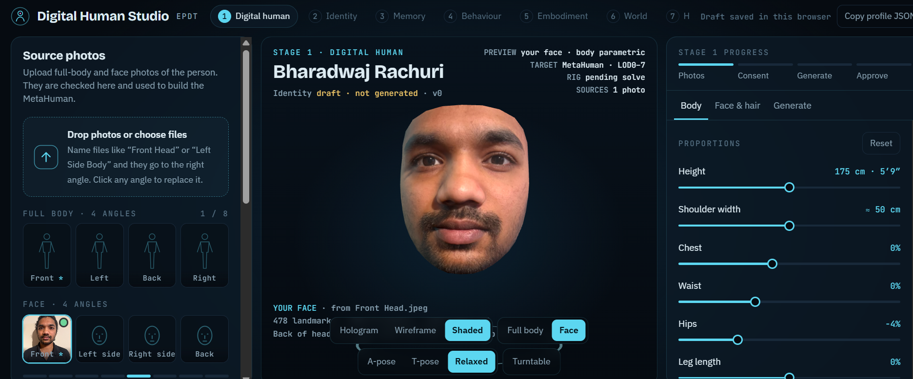

# Embodied Personal Digital Twin

**A provenance-aware digital twin of a real, consenting person: measurably faithful in appearance, and honest about what it remembers.**




*Digital Human Studio, Stage 1. A 3D face mesh (478 MediaPipe landmarks) textured from the subject's own front photo. The MetaHuman conform step is not connected yet; see [Limitations](#limitations).*

---

## Overview

The project builds a persistent digital model of one consenting person (appearance, voice, memories, relationships, routines) and gives it a body, so it can **perceive, remember, reason and act** in a simulated world.

It is built on two tracks that are designed to converge:

| Track | Purpose | Current state |
|---|---|---|
| **1. Digital-human reconstruction** | Rebuild face, head and body from photographs, and score the result against those photographs | **v4** |
| **2. Embodied-agent console** | Perception, memory, reasoning, planning and action in a 3D home | **v1 prototype** (sample data) |

The end state is the reconstructed human driving the embodied agent.

## Design principles

1. **Fidelity is a number.** Every reconstruction change is scored against the reference photos (outline overlap, landmark error, profile error in mm), and a change that makes any of those worse is rejected.
2. **Memory carries provenance.** Every fact is tagged *Verified*, *User-provided*, *Inferred*, *Reconstructed* or *Unknown*. When a fact is unknown, the agent says so instead of inventing it.
3. **Consent is a requirement.** Identity, consent and revocability are part of the data model from the start, not added later.
4. **Limitations are published.** Known defects are listed in this repository next to the results.

## Track 1: Digital-human reconstruction

A single connected head-and-body mesh is fitted to 8 phone photographs (4 head views, 4 body views).

**Pipeline**

1. **Photo QA and segmentation:** resolution, lighting, sharpness and orientation checks; MediaPipe multiclass segmentation.
2. **Template fit:** a CC0 MakeHuman base mesh is shaped to the body silhouettes (MediaPipe Pose) and morphed to 453 face landmarks.
3. **Profile correction:** side-photo depth is applied only where both side photos agree within 8 mm.
4. **Eyes and neck:** anatomically placed eyeballs with lid deformation toward the photographed opening; welded normals across the neck seam.
5. **Full head (v4):** skull fit to all four head outlines under a pinhole camera model, plus a measured hair-volume shell.
6. **Texture baking:** UV textures from 8 projections, weighted by view angle, with photometric normalisation and segmentation-aware masking.

**Results against the reference photos**

| Metric | v2 | v3 | v4 |
|---|---|---|---|
| Eye-opening IoU | 0.60 | **0.80** | 0.80 |
| Front landmark error, nose / lips / jaw (px) | 4.5 / 6.7 / 6.8 | **3.7 / 3.4 / 4.6** | 3.7 / 3.4 / 4.6 |
| Side-profile error, left / right (mm) | 7.1 / 8.2 | **5.5 / 7.3** | 5.5 / 7.3 |
| Neck-seam normal agreement (min dot) | −0.27 | **1.000** | 1.000 |
| Head outline IoU: front | 0.88 (v3) | n/a | **0.914** |
| Head outline IoU: left / right | 0.80 / 0.83 (v3) | n/a | **0.897 / 0.914** |
| Head outline IoU: back | 0.80 (v3) | n/a | 0.79 (no better) |

**Validation:** `pytest` runs 25 tests (structure, textures, closed surface, no shading seam, eye geometry, landmark and profile regression, head-outline improvement). A Playwright viewer suite runs 71 checks across v1–v4 at desktop and phone sizes, in three render modes.

Full write-ups: [REPORT_v2](REPORT_v2.md) · [REPORT_v3](REPORT_v3.md) · REPORT_v4

## Track 2: Embodied-agent console

A single-page Three.js scene with one digital person, a small flat, four tracked objects and two household relationships, driven by a nine-stage pipeline:

`Perceive → Understand → Remember → Reason → Plan → Move → Interact → Verify → Communicate`

- **Provenance-aware memory:** memory-only questions answer with their provenance and refuse to fabricate.
- **Belief-driven search:** for "Where are my keys?" and "Daddy, can you get me the book?", the agent searches the last-seen place, then the usual place, then sweeps the remaining surfaces. It updates beliefs from what it sees and replans mid-route when an object has been moved out of sight.
- **Model versioning:** each task that adds memories bumps the model version, and the Versions tab shows which memory caused which change.

Details: [twin-console-v1.md](twin-console-v1.md)

## Roadmap

✅ done · 🚧 in progress · ⬜ planned

| # | Stage | Delivers | Status |
|---|---|---|---|
| 1 | Digital human | Measurable face, head and body from photos | 🚧 v4; body proportions still assumed |
| 2 | Personal identity | Appearance and voice tied to one authorised person | 🚧 appearance; voice next |
| 3 | Lifelong memory | Persistent store with provenance and confidence | 🚧 schema and prototype on sample data |
| 4 | Personality and behaviour | Reasoning that reflects the person's preferences | ⬜ |
| 5 | Embodiment | A body in 3D; perception drives action | 🚧 console v1 |
| 6 | Persistent virtual world | A home that keeps state between sessions | ⬜ |
| 7 | Household intelligence | Multi-object, multi-person tasks | 🚧 two benchmark tasks |
| 8 | Lifelong learning and versioning | Tracked, reversible improvement | ⬜ |
| 9 | Legacy mode (opt-in) | Preservation under explicit, revocable permissions | ⬜ design only |

**Next:** real tape measurements and 3–4 m body photos; 8–12 multi-angle face photos; photogrammetry walk-around for hair and clothing; MetaHuman conform; LLM tool-calling in place of keyword intent parsing; driving the console with the reconstructed mesh.

## Quick start

```bash
# viewer (serves the app locally)
app/start.bat            # then open http://localhost:8000/my-twin.html

# tests
pip install -r requirements.txt
python -m pytest tests -q
node tests/viewer.test.js
```

## Repository layout

```
app/        Three.js viewer and Studio UI, models, local server script
tools/      v1 silhouette pipeline (seg, recon_head, recon_body, merge)
tools/twin/ v2–v4 fitted-template pipeline (fit_body, build_twin*, facefit, headfit, hairshell, audits)
tests/      pytest model tests and Playwright viewer tests
docs/       images and supporting material
REPORT_*.md Versioned audit, change and validation reports
```

## Limitations

- **Hair and clothes are painted on**, not modelled. Hair is a smooth shell without strands.
- **Body height and lengths are assumed** (1.75 m). The close, downward-angled photos cannot support measured proportions.
- **Lips and chin sit 3–10 mm behind the side-photo outline**, partly because beard and moustache are not geometry.
- **Back of the head is no better in v4**, because the four photos disagree about its width.
- **Ears, fingers and toes come from the template.**
- **Not rigged or MetaHuman-conformed yet.** Photogrammetry and the MetaHuman step are the next integration.
- **The console runs on sample data.** Intent parsing is keyword-based and voice is browser TTS.
- Runs locally; this is a research build, not a deployed product.

## Ethics and consent

This is self-model work: the subject, builder and consenting party are the same person. The Studio requires explicit consent before generation, and the roadmap treats revocable permissions as a precondition for any legacy mode.

## Credits

[MakeHuman](http://www.makehumancommunity.org/) base mesh (CC0) · [MediaPipe](https://developers.google.com/mediapipe) landmarks, pose and segmentation · [three.js](https://threejs.org/) · Playwright · pytest

## Author

**Bharadwaj Rachuri**, ML and AI Engineer · [br23aay.github.io](https://br23aay.github.io) · [github.com/br23aay](https://github.com/br23aay)

Background: MSc project training the Shadow Dexterous Hand with PPO in MuJoCo, which is the source of the "an agent optimises whatever you mis-specify" lesson behind this project.
